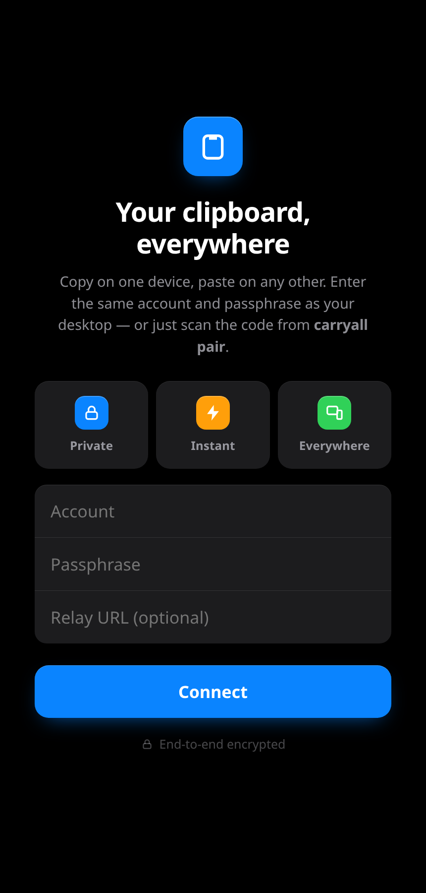
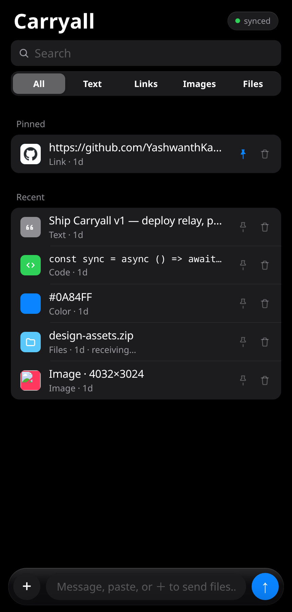

<div align="center">

# Carryall

### Your clipboard, on every device — instant, private, end-to-end encrypted.

[](https://github.com/YashwanthKamireddi/Carryall/actions/workflows/ci.yml)
[](LICENSE)


-555)


Copy something on one device and it’s **instantly on your other devices’ native clipboard** — ready to paste. A **3.4 MB headless daemon** does the work at near-zero idle CPU; your phone gets a clean installable web app. The server only ever sees ciphertext.

<br />


&nbsp;&nbsp;


</div>

---

## Features

- **🔁 Automatic cross-device sync** — copy here, paste there. Incoming clips land straight on the native clipboard, ready to paste.
- **🧬 Everything you copy** — text, links, code, colors, images, **files & folders**, video, audio — full-quality, byte-for-byte.
- **🔒 End-to-end encrypted** — AES-256-GCM, key derived from your passphrase. Keys never leave your devices; the relay only moves ciphertext.
- **📱 Phone app, no app store** — installable PWA on iOS *and* Android: tap to copy, long-press to preview/edit, paste or drag files to send, full-text search, pins, filters.
- **⚡ Two transports** — a direct **LAN fast-path** (mDNS) when devices are nearby, and an **always-on relay** for anywhere else.
- **🪶 Featherweight** — a ~3.4 MB headless daemon at **~0% idle CPU** and ~6 MB RAM. No GUI, no WebView, no Electron, no JVM.
- **🛡️ Private by default** — sync is off until you set an account; password-manager clips are skipped.
- **🔍 Full history, searchable** — every clip is kept (with retention controls) and instantly searchable, not a single 2-minute slot.

## How it works

```
  carryall daemon ──watch native clipboard──▶  SQLite + FTS5 history
        │  ▲ apply incoming clips to the native clipboard
        │  └──────────────────────────────────────────────┐
        │  gzip ─▶ AES-256-GCM  (relay sees ciphertext only)│
        ├── LAN direct (mDNS-discovered TCP) ───────────────┤  your other devices
        └── relay (WebSocket, durable backlog) ─────────────┤
                                                            └── phone PWA
```

The daemon hooks the native OS clipboard — event-driven on Wayland (`wl-paste --watch`), `clipboard-rs` on X11/Windows/macOS — classifies and content-addresses every copy with **blake3**, stores it in **SQLite + FTS5**, and syncs it. Two devices on the same network sync directly through the **mDNS LAN fast-path**, skipping the cloud entirely; otherwise a lightweight **axum WebSocket relay** fans encrypted blobs out and also serves the phone PWA. Large files are split into 256 KiB content-addressed chunks, so identical content never transfers twice.

**The path of a copy:** capture → **gzip** → **AES-256-GCM** → LAN-direct *or* relay → decrypt → land on the other device’s native clipboard. Compression happens *before* encryption — ciphertext can’t be compressed, so that’s the one place a size win is real.

## Fast & efficient by design

Carryall is built to disappear into the background and move data as fast as the network physically allows. Measured on a release build (Linux, 2026-06):

| | Carryall |
|---|---|
| Daemon binary | **3.4 MiB** |
| Idle RAM (RSS) | **~6.4 MB** |
| Idle CPU | **~0%** — event-driven capture, no polling loop |
| gzip on a code snippet | **75% smaller** on the wire |
| gzip on a text paragraph | **92% smaller** |
| Tiny payloads (a URL) | sent **raw** — never inflated |
| Blob chunks | 256 KiB, pipelined |
| Small-clip sync | one frame, no round-trip on an open link — perceived-instant on LAN |

Under the hood: capture is **event-driven** (it waits on the OS, never polls), so idle cost is effectively zero. Payloads are **gzip-compressed before encryption**, so text and code fly across the wire. Large files stream as **pipelined 256 KiB content-addressed chunks** with **blake3** dedup. Sync survives drops — clips captured while offline **replay automatically on reconnect**, and the relay keeps a **durable backlog** so a restart never loses your catch-up.

## Quick start — one command

**No Rust needed** — this downloads the prebuilt binary for your OS, generates your key, writes the config, and installs autostart:

```bash
# macOS / Linux
curl -fsSL https://raw.githubusercontent.com/YashwanthKamireddi/Carryall/main/install.sh | sh
```
```powershell
# Windows (PowerShell)
irm https://raw.githubusercontent.com/YashwanthKamireddi/Carryall/main/install.ps1 | iex
```

That’s it — Carryall is now capturing and syncing in the background.

**From source** (if you have Rust): `git clone … && cd Carryall && ./setup.sh` (add `-y` to skip prompts). Prebuilt binaries for every OS/arch are on the [Releases](https://github.com/YashwanthKamireddi/Carryall/releases) page.

### Pair your phone in one scan

```bash
carryall pair        # prints a QR in your terminal
```

Scan it with your phone’s camera — the app opens, fills in your account, and connects. The account + key ride in the URL **fragment**, so they never reach the server. Then **Add to Home Screen** and you’re set; it stays signed in and reconnects on its own.

## Security

- **AES-256-GCM**, key derived from your passphrase via **PBKDF2-HMAC-SHA256** — the key never leaves your devices.
- The relay and LAN transports carry **only ciphertext**; payloads are gzip-compressed *before* encryption, and every received blob is integrity-checked against its content hash.
- Sync is **off until you configure an account** — fully local and private by default.

## Architecture

| Crate | Responsibility |
|---|---|
| `cli` | the `carryall` binary — capture, sync (LAN + relay), apply-to-clipboard |
| `crates/clip-core` | content model, classifier, blake3 content-addressing |
| `crates/clip-store` | SQLite + FTS5 history — dedup, pins, search, retention, tombstones |
| `crates/clip-sync` | HLC ordering, CRDT merge, E2E crypto, gzip, chunking |
| `server` | the `carryall-relay` binary — encrypted fan-out (never decrypts) + the phone PWA |

## Development

```bash
cargo test     # full workspace incl. an end-to-end sync test
cargo clippy   # CI enforces -D warnings
cargo fmt
```

## License

[MIT](LICENSE) © Yashwanth Kamireddi
